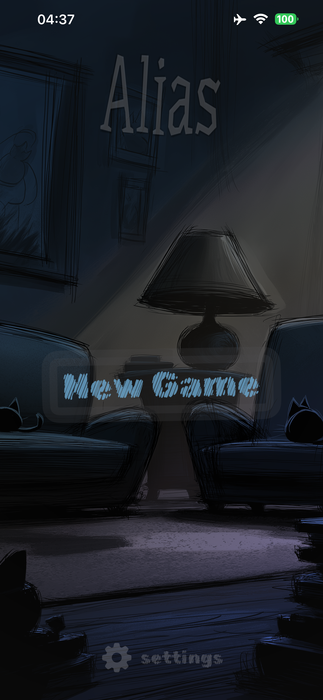
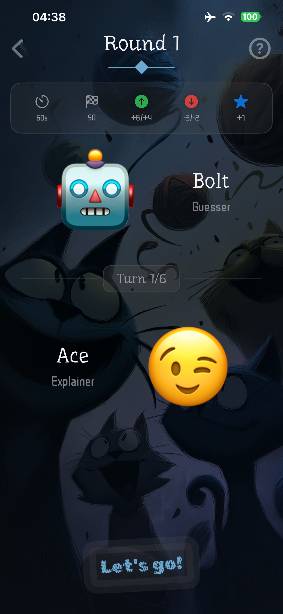

# Alias

Alias is a SwiftUI party word game for iPhone and iPad. Players take turns explaining words to each other, scoring points for guessed words and losing points for skips. The app includes built-in dictionaries and can generate custom dictionaries through OpenRouter.

## Screenshots

| Home | New Game | Turn Start | Gameplay |
| --- | --- | --- | --- |
|  |  |  |  |

## Features

- Localized UI in English, Ukrainian, and Russian.
- Built-in Easy, Medium, and Hard dictionaries.
- AI-generated custom dictionaries through OpenRouter with player-configurable API key and model name.
- Streaming generation progress with visible word-count updates.
- Configurable round time, points to win, scoring, penalties, and last-word bonus.
- SwiftUI navigation flow: Home -> New Game -> Turn Start -> Gameplay -> Results -> Winner.
- Sound and haptic feedback toggles.

## Requirements

- Xcode 26 or newer.
- iOS 26 SDK or compatible simulator/device.
- Optional: an OpenRouter API key for AI dictionary generation.

## OpenRouter Setup

The app does not store an API key in source code. Each player can enter their own OpenRouter API key and model in the in-app settings sheet from the home screen. The API key is saved in Keychain on that device, and the model name defaults to:

```text
openai/gpt-5.6-luna
```

For local development you can instead set `OPENROUTER_API_KEY` in the Xcode scheme environment; it is used only when no key is saved in settings.

Generation streams an OpenRouter chat completion with a strict JSON schema and minimal reasoning effort. Words are parsed incrementally as they arrive, de-duplicated, and the dialog shows live progress. The list size is `max(300, players × 100)`; a result with fewer than half of the requested words is rejected with a readable error. Generated dictionaries live in memory for the current game setup and are never written to disk.

## Release Hygiene

The repository ignores Xcode user data, build products, local environment files, and common secret files. Do not commit private API keys, local `.xcuserstate` files, `.DS_Store`, or provisioning/signing artifacts.

## Project Structure

- `Alias/App`: app entry point, root view, and `AppRouter` (typed navigation path).
- `Alias/Game`: `GameSession`, the observable game state machine (turn order, scoring, undo of the last turn).
- `Alias/Models`: value types for players, settings, turns, dictionaries, and languages.
- `Alias/Services`: OpenRouter client and dictionary generator, settings and Keychain storage, feedback, built-in word lists.
- `Alias/Features`: one folder per screen (Splash, Home, Settings, NewGame, TurnStart, Gameplay, TurnResults, Winner).
- `Alias/Shared`: reusable SwiftUI components and preview support.
- `Alias/Core`: localization accessors, theme, and constants.
- `Alias/Resources`: assets, fonts, and localization files.
- `AliasTests`: Swift Testing suites.

## Navigation

Home is the root of the `NavigationStack`. New Game is pushed on top of it, and each in-game screen replaces the screen above New Game, so the stack is always `[newGame, current]` during a game:

```text
Home → New Game → Turn Start → Gameplay → Turn Results → Turn Start … → Winner
```

- Back on the first Turn Start returns to New Game with the setup intact.
- Back on a later Turn Start reopens the previous turn's results (`GameSession.returnToLastTurn()`), including across a round boundary, without double-scoring.
- Leaving Gameplay through the home button or Winner → Home clears the stack; Winner → Again restarts with the same players.

## Build

```sh
xcodebuild build -project "Alias.xcodeproj" -scheme "Alias" -destination 'platform=iOS Simulator,name=iPhone 17'
```

## Test

```sh
xcodebuild test -project "Alias.xcodeproj" -scheme "Alias" -destination 'platform=iOS Simulator,name=iPhone 17' -only-testing:AliasTests
```

`OpenRouterLiveTests` calls the real API and runs only when a key is passed to the test runner:

```sh
TEST_RUNNER_OPENROUTER_API_KEY=sk-or-... TEST_RUNNER_OPENROUTER_MODEL=openai/gpt-5.6-luna \
  xcodebuild test -project "Alias.xcodeproj" -scheme "Alias" -destination 'platform=iOS Simulator,name=iPhone 17' -only-testing:AliasTests/OpenRouterLiveTests
```

If the simulator service is unhealthy, reboot the selected simulator and rerun the command.

## Localization

Localization lives in:

- `Alias/Resources/Localization/en.lproj/Localizable.strings`
- `Alias/Resources/Localization/uk.lproj/Localizable.strings`
- `Alias/Resources/Localization/ru.lproj/Localizable.strings`

When adding user-visible text, add a key to all three files and expose it through `L` in `Core/Localization.swift`.
